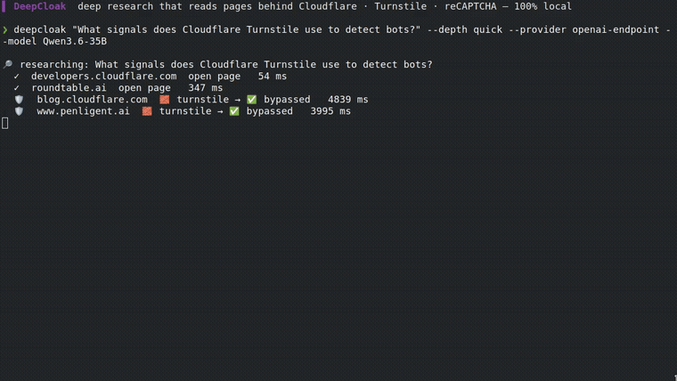

<div align="center">

<h1>🛡️ DeepCloak</h1>

### 가져오기 결정과 근거를 남기는 로컬 우선 리서치 도구.

**Cloudflare · Datadome · Turnstile · reCAPTCHA — 그냥 통과해서 본문을 가져옵니다.**

[](https://pypi.org/project/deepcloak/)
[](https://github.com/Mrbaeksang/deepcloak/actions/workflows/ci.yml)
[](LICENSE)
[](pyproject.toml)
[](#-ai-에이전트에서-쓰기)
[](CONTRIBUTING.md)
[](https://github.com/Mrbaeksang/deepcloak/stargazers)
[](https://youtu.be/p5ompjDLzaI)

[English](README.md) · **한국어** · [简体中文](README.zh-CN.md)

[빠른 시작](#-빠른-시작) · [작동 방식](#-작동-방식) · [에이전트에 연결 (MCP)](#-에이전트에-연결-mcp) · [왜 만들었나](#-왜-만들었나) · [변경 이력](CHANGELOG.md)

### [▶ 라이브 데모 — deepcloak.vercel.app](https://deepcloak.vercel.app)  ·  [▶ 유튜브로 보기](https://youtu.be/p5ompjDLzaI)

[](https://youtu.be/p5ompjDLzaI)

</div>

---

## 문제

리서치 도구에 질문을 합니다. 일부 소스는 Cloudflare, DataDome 챌린지 같은 **봇 차단(Bot Wall)** 뒤에 있습니다. `403`을 받은 도구는 그 페이지를 버리고, 무엇을 놓쳤는지 말하지 않은 채 더 얇은 리포트를 줄 수 있습니다.

## DeepCloak이 하는 일

DeepCloak은 이 결정을 드러냅니다. plain fetch가 봇 차단에 막히면 그 URL을 브라우저의 **Stealth Fetch로 에스컬레이트**합니다. 돌아온 내용을 다시 검사해서, 더 이상 챌린지 페이지가 아닐 때만 **Bypass**로 기록합니다. 리포트 끝에 그 수를 알려주고, URL마다 실패와 건너뜀까지 **Evidence Record**로 남깁니다. 성공 여부는 소스와 접근 제어에 달려 있습니다.

[`local-deep-research`](https://github.com/LearningCircuit/local-deep-research)(리서치 루프) + [`CloakBrowser`](https://github.com/CloakHQ/CloakBrowser)(스텔스 브라우저) 위의 얇은 로컬 우선 오케스트레이터입니다. **CLI · MCP 서버 · Claude 스킬**로 사용. MIT.

## 🌑 왜 만들었나

봇 체크 뒤에 있는 글이 늘고 있고, 리서치 에이전트는 말없이 그 글을 놓칠 수 있습니다. 소스를 조용히 건너뛴 리포트는 알아챌 수 없는 방식으로 틀린 리포트입니다.

DeepCloak의 입장은 단순합니다: **리서치 도구는 근거를 보여줘야 합니다.** 기본으로 `robots.txt`를 지키고, 일반 요청에서 자신을 밝히고, 필요할 때만 Stealth Fetch를 시도하고, 결과를 Evidence Record로 출력합니다. 프로세스는 로컬에서 돌지만, 검색 엔진은 쿼리를, 원본 사이트는 요청을, 설정한 클라우드 LLM은 리서치 맥락을 받습니다. 맥락을 PC 밖으로 내보내지 않으려면 로컬 LLM을 쓰세요.

## ✨ 뭐가 다른가

|  | 근거 기록이 없는 도구 | **DeepCloak** |
| --- | :---: | :---: |
| 열린 웹 읽기 | ✅ | ✅ |
| 봇 차단 뒤의 페이지 | 조용히 버려지는 경우가 많음 | 브라우저로 재시도, 결과 기록 |
| 어떤 소스가 막혔고, 건너뛰었고, 실패했는지 알려줌 | ❌ | ✅ Evidence Record |
| 로컬 우선 (API 키 불필요) | ✅ | ✅ |
| 열린 페이지는 빠르게 | — | ✅ *plain 우선, 필요할 때만 스텔스* |

> **실행 녹화.** 위 영상은 `deepcloak` 0.1.0을 **로컬 LLM(Qwen) + SearXNG, API 키 없이** 실행한 **편집 없는 화면 녹화**입니다. 이 실행에서 Cloudflare/Turnstile Bypass 8건이 보고됐습니다. 현재의 재검사가 들어가기 전 기록이고, 결과는 실행과 소스마다 다릅니다. 전체 클립: [`docs/media/demo-real.mp4`](docs/media/demo-real.mp4), 원본 세션: [`docs/media/demo.cast`](docs/media/demo.cast). 그 밖의 업체별 성공은 주장하지 않습니다.

## 🚀 빠른 시작

```bash
pip install deepcloak
deepcloak setup                       # 1회: 스텔스 브라우저 내려받기
export OPENAI_API_KEY=...             # 또는 ANTHROPIC_API_KEY / GEMINI_API_KEY — 또는 --provider ollama
deepcloak "웹사이트는 봇을 어떻게 감지할까?" --depth detailed --out report.md
```

인용 포함 `report.md` (끝에 `🛡️ Bypassed N bot-walled sources` 섹션) + `report.md.evidence.json` 사이드카가 생깁니다.

## 🧠 작동 방식

```
검색 (DuckDuckGo, 설정 불필요) ─▶ 후보 URL
        │
        ▼  페이지마다:
   plain fetch ─▶ 봇 차단 감지? ──아니오──▶ 사용 (빠름)
                        │ 예
                        ▼
                  에스컬레이트 ─▶ Stealth Fetch (CloakBrowser) ─▶ Bypass
        │
        ▼
리서치 루프 (local-deep-research) ─▶ 인용 리포트 + Evidence Records
```

스텔스는 무거워서, 먼저 싼 plain fetch를 하고 **봇 차단을 실제로 감지했을 때만** 스텔스 브라우저를 띄웁니다(`--stealth auto`, 기본). `--depth detailed`/`report`가 풀페이지를 가져와 Bypass가 일어납니다.

## 🤖 에이전트에 연결 (MCP)

DeepCloak은 stdio **MCP 서버**로 동작 — `deep_research(query, depth)`, `quick_summary(query)`, `get_evidence(run_id)` 노출.

**Claude Code** — 프로젝트 `.mcp.json`에 추가(예시 파일 레포에 동봉):

```json
{ "mcpServers": { "deepcloak": { "command": "deepcloak", "args": ["mcp"] } } }
```

**Codex** — `~/.codex/config.toml`에 추가:

```toml
[mcp_servers.deepcloak]
command = "deepcloak"
args = ["mcp"]
```

그러면 에이전트가 `deep_research`를 호출해 봇월 막힌 소스까지 직접 읽음. 슬래시 스킬이 좋으면 [`skill/SKILL.md`](skill/SKILL.md)를 `~/.claude/skills/deepcloak/`에.

## ⚙️ 설정

| 플래그 | 기본값 | 비고 |
| --- | --- | --- |
| `--depth` | `detailed` | `quick` / `detailed` / `report` |
| `--engine` | `duckduckgo` | `searxng` / `auto` |
| `--stealth` | `auto` | `always` / `off` |
| `--provider` / `--model` | 자동감지 | `OPENAI_API_KEY` → `ANTHROPIC_API_KEY` → `GEMINI_API_KEY` → `OPENROUTER_API_KEY`; 또는 `ollama` / `lmstudio` / `llamacpp` / `openai-endpoint` (`--base-url`) |
| `--ignore-robots` | 끔 | robots.txt가 금지해도 가져옴. Evidence Record에 기록됨 |
| `--allow-private-urls` | off | localhost와 사설 네트워크 주소 허용 (기본은 차단) |
| `--proxy` | — | Stealth Fetch용 SOCKS5 |
| `--json` | 끔 | 결과 전체(리포트 + Evidence Record + 설정)를 JSON으로 출력 |

**모델 고르기:** `deepcloak models --provider openrouter`로 프로바이더가 제공하는 모델 목록 확인 (전 프로바이더 지원, 로컬 서버는 `--base-url`). 이후 `--model <id>`로 지정. 설정은 `~/.config/deepcloak/config.toml`에 저장 가능(`$DEEPCLOAK_CONFIG`로 경로 변경). 우선순위: CLI 플래그 > 환경변수 > 설정 파일.

## ⚠️ 책임 있는 사용

DeepCloak은 막힌 페이지를 스텔스 브라우저로 재시도할 수 있습니다. **가져오는 콘텐츠에 접근할 권리는 사용자의 책임입니다.** robots.txt는 **기본으로 지키며**, `--ignore-robots`로 무시할 수 있습니다 ([ADR-0003](docs/adr/0003-honor-robots-by-default.md)). 일반 요청은 DeepCloak임을 밝히지만 브라우저 재시도는 그렇지 않습니다. 사이트 약관이나 법을 어기는 데 쓰지 마세요.

## 🗺️ 로드맵

- Bot Wall 시그니처 추가 + 더 똑똑한 Escalation 휴리스틱
- DuckDuckGo / SearXNG 외 검색 백엔드 추가
- Bypass한 페이지 런 간 캐싱
- Evidence Record 내보내기 강화 (HTML / JSON 스키마)

아이디어 환영 — [Discussion](https://github.com/Mrbaeksang/deepcloak/discussions) 열거나 [기능 제안](https://github.com/Mrbaeksang/deepcloak/issues/new/choose) 주세요.

## 🛠️ 기반

[`local-deep-research`](https://github.com/LearningCircuit/local-deep-research)(MIT) + [`CloakBrowser`](https://github.com/CloakHQ/CloakBrowser)(MIT), pip 의존 — 코드 벤더링 X. 용어집 [CONTEXT.md](CONTEXT.md), 설계 결정 [docs/adr/](docs/adr/), 기여 가이드 [CONTRIBUTING.md](CONTRIBUTING.md).

## 📄 라이선스

MIT — [LICENSE](LICENSE), [NOTICE](NOTICE) 참고.

<div align="center">

**마지막 도구가 포기한 페이지를 DeepCloak이 읽어줬다면, ⭐ 하나 — 다른 사람들이 찾는 데 도움돼요.**

만든 사람 **[Mrbaeksang](https://baeksang.dev)** · [baeksang.dev](https://baeksang.dev) · [contact@baeksang.dev](mailto:contact@baeksang.dev)

[](https://star-history.com/#Mrbaeksang/deepcloak&Date)

</div>
