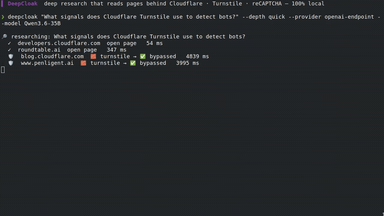

<div align="center">

<h1>🛡️ DeepCloak</h1>

### Local-first research with explicit fetch decisions and evidence.

A CLI and MCP wrapper around local-deep-research and CloakBrowser. It retries selected failed fetches in a browser and records the result. Success depends on the source and its access controls.

[](https://pypi.org/project/deepcloak/)
[](https://github.com/Mrbaeksang/deepcloak/actions/workflows/ci.yml)
[](LICENSE)
[](pyproject.toml)
[](#-use-it-from-an-ai-agent)
[](CONTRIBUTING.md)
[](https://github.com/Mrbaeksang/deepcloak/stargazers)
[](https://youtu.be/p5ompjDLzaI)

**English** · [한국어](README.ko.md) · [简体中文](README.zh-CN.md)

[Quickstart](#-quickstart) · [How it works](#-how-it-works) · [Use from an agent (MCP)](#-connect-it-to-your-agent-mcp) · [Why we built it](#-why-we-built-this) · [Changelog](CHANGELOG.md)

### [▶ Live demo — deepcloak.vercel.app](https://deepcloak.vercel.app)  ·  [▶ Watch on YouTube](https://youtu.be/p5ompjDLzaI)

[](https://youtu.be/p5ompjDLzaI)

</div>

---

## The problem

You ask a research tool a question. Some sources sit behind a **Bot Wall**, such as a Cloudflare or DataDome challenge. A tool that gets a `403` may drop those pages and hand you a thinner report without saying what it missed.

## What DeepCloak does

DeepCloak makes those decisions visible. When a plain fetch hits a Bot Wall, it **Escalates** that URL to a **Stealth Fetch** in a browser. It re-checks what comes back, and records a **Bypass** only if the page is no longer a challenge. Every report ends with the count, and every URL gets an **Evidence Record** saying what happened, including failures and skips. Success depends on the source and its access controls.

It's a thin, local-first orchestrator over two great projects: [`local-deep-research`](https://github.com/LearningCircuit/local-deep-research) (the research loop) and [`CloakBrowser`](https://github.com/CloakHQ/CloakBrowser) (the stealth browser). Use it as a **CLI**, an **MCP server**, or a **Claude skill**. MIT.

## 🌑 Why we built this

More writing now sits behind a bot check, and research agents can miss it without saying so. A report that silently skips sources is wrong in a way you can't see.

DeepCloak's stance is simple: **a research tool should show its evidence.** It honors `robots.txt` by default, identifies itself on plain requests, attempts a Stealth Fetch only when one is needed, and prints an Evidence Record of the result. The process runs locally; search engines receive queries, source websites receive requests, and a configured cloud LLM receives research context. Choose a local LLM when that context must stay on the machine.

## ✨ Why it's different

|  | Without an evidence trail | **DeepCloak** |
| --- | :---: | :---: |
| Reads the open web | ✅ | ✅ |
| A page behind a Bot Wall | often dropped silently | retried in a browser, result recorded |
| Tells you which sources were walled, skipped or failed | ❌ | ✅ Evidence Record |
| Local-first (no API key required) | ✅ | ✅ |
| Fast on open pages | — | ✅ *plain-first, stealth only when needed* |

> **Recorded run.** The clip above is an **unedited screen recording** of `deepcloak` 0.1.0 with a **local LLM (Qwen) + SearXNG, no API key**. In that run it reported 8 Cloudflare/Turnstile Bypasses. It predates the current re-check, and results vary by run and by source. Full clip: [`docs/media/demo-real.mp4`](docs/media/demo-real.mp4); raw session: [`docs/media/demo.cast`](docs/media/demo.cast). No other per-vendor success is claimed here.

## 🚀 Quickstart

```bash
pip install deepcloak
deepcloak setup                       # one-time: downloads the stealth browser
export OPENAI_API_KEY=...             # or ANTHROPIC_API_KEY / GEMINI_API_KEY — or --provider ollama
deepcloak "How do websites detect bots?" --depth detailed --out report.md
```

You get a cited `report.md`, plus a `report.md.evidence.json` sidecar. When a Stealth Fetch succeeded, the report ends with a `🛡️ Bypassed N bot-walled sources` section.

## 🧠 How it works

```
search (DuckDuckGo, no setup) ─▶ candidate URLs
        │
        ▼  for each page:
   plain fetch ─▶ Bot Wall detected? ──no──▶ use it (fast)
                        │ yes
                        ▼
                  Escalate ─▶ Stealth Fetch (CloakBrowser) ─▶ Bypass
        │
        ▼
research loop (local-deep-research) ─▶ cited report + Evidence Records
```

Stealth is heavy, so DeepCloak tries a cheap plain fetch first and only launches the browser when it detects a Bot Wall (`--stealth auto`, the default). Use `--depth detailed`/`report` to fetch full pages.

## 🤖 Connect it to your agent (MCP)

DeepCloak runs as a stdio **MCP server** exposing `deep_research(query, depth, provider, model)`, `quick_summary(query, provider, model)`, `get_evidence(run_id)`, and `list_models(provider)`.

**Claude Code** — add to your project's `.mcp.json` (an example ships in this repo):

```json
{ "mcpServers": { "deepcloak": { "command": "deepcloak", "args": ["mcp"] } } }
```

**Codex** — add to `~/.codex/config.toml`:

```toml
[mcp_servers.deepcloak]
command = "deepcloak"
args = ["mcp"]
```

Then your agent can call `deep_research` and read bot-walled sources directly. Prefer a slash-style skill? Drop [`skill/SKILL.md`](skill/SKILL.md) into `~/.claude/skills/deepcloak/`.

## ⚙️ Configuration

| Flag | Default | Notes |
| --- | --- | --- |
| `--depth` | `detailed` | `quick` / `detailed` / `report` |
| `--engine` | `duckduckgo` | `searxng` / `auto` |
| `--stealth` | `auto` | `always` / `off` |
| `--provider` / `--model` | auto-detected | `OPENAI_API_KEY` → `ANTHROPIC_API_KEY` → `GEMINI_API_KEY` → `OPENROUTER_API_KEY`; or `ollama` / `lmstudio` / `llamacpp` / `openai-endpoint` (`--base-url`) |
| `--ignore-robots` | off | fetch even when robots.txt disallows it; recorded in each Evidence Record |
| `--allow-private-urls` | off | allow localhost and private network addresses (blocked by default) |
| `--proxy` | — | SOCKS5 for the Stealth Fetch |
| `--json` | off | print the full result (report + Evidence Records + settings) as JSON |

**Picking a model:** list what a provider offers with `deepcloak models --provider openrouter` (works for every provider; local servers via `--base-url`), then pass `--model <id>`. With several credentials in your environment and a real terminal, DeepCloak simply asks. Settings persist in `~/.config/deepcloak/config.toml` (override with `$DEEPCLOAK_CONFIG`); precedence: CLI flags > environment > config file.

**Run history:** finished runs are saved to `~/.local/share/deepcloak/runs/` — browse with `deepcloak runs`, replay a report with `deepcloak show <id>` (`--json` for the full record).

## ⚠️ Responsible use

DeepCloak can retry a blocked page in a stealth browser. **You are responsible for having the right to access whatever you fetch.** robots.txt is **honored by default**, and `--ignore-robots` overrides it ([ADR-0003](docs/adr/0003-honor-robots-by-default.md)). Plain requests identify themselves as DeepCloak; the browser retry does not. Don't use it to violate sites' terms or the law.

## 🗺️ Roadmap

- Fewer false verdicts in Bot Wall detection and the Bypass re-check
- More search backends beyond DuckDuckGo / SearXNG
- Cache fetched pages across runs
- Richer Evidence Record export (HTML / JSON schema)

Ideas welcome — start a [Discussion](https://github.com/Mrbaeksang/deepcloak/discussions) or open a [feature request](https://github.com/Mrbaeksang/deepcloak/issues/new/choose).

## 🛠️ Built on

[`local-deep-research`](https://github.com/LearningCircuit/local-deep-research) (MIT) + [`CloakBrowser`](https://github.com/CloakHQ/CloakBrowser) (MIT), via pip — no vendored code. Domain glossary in [CONTEXT.md](CONTEXT.md); design decisions in [docs/adr/](docs/adr/); contributing guide in [CONTRIBUTING.md](CONTRIBUTING.md).

## 📄 License

MIT — see [LICENSE](LICENSE) and [NOTICE](NOTICE).

<div align="center">

**If DeepCloak's evidence helped your research, drop a ⭐. It helps others find it.**

Built and maintained by **[Sanghyeon Baek (백상현 · @Mrbaeksang)](https://baeksang.dev)** · [baeksang.dev](https://baeksang.dev) · [contact@baeksang.dev](mailto:contact@baeksang.dev)

[](https://star-history.com/#Mrbaeksang/deepcloak&Date)

</div>
