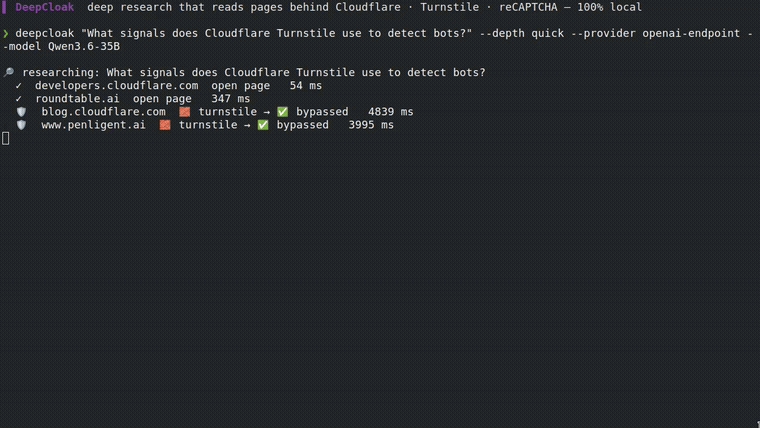

<div align="center">

<h1>🛡️ DeepCloak</h1>

### 记录抓取决策与证据的本地优先研究工具。

**Cloudflare · Datadome · Turnstile · reCAPTCHA —— 直接穿过它们，把正文带回来。**

[](https://pypi.org/project/deepcloak/)
[](https://github.com/Mrbaeksang/deepcloak/actions/workflows/ci.yml)
[](LICENSE)
[](pyproject.toml)
[](#-在-ai-智能体中使用)
[](CONTRIBUTING.md)
[](https://github.com/Mrbaeksang/deepcloak/stargazers)
[](https://youtu.be/p5ompjDLzaI)

[English](README.md) · [한국어](README.ko.md) · **简体中文**

[快速开始](#-快速开始) · [工作原理](#-工作原理) · [接入智能体 (MCP)](#-接入你的智能体-mcp) · [我们为何要做它](#-我们为何要做它) · [更新日志](CHANGELOG.md)

### [▶ 在线演示 — deepcloak.vercel.app](https://deepcloak.vercel.app)  ·  [▶ 在 YouTube 观看](https://youtu.be/p5ompjDLzaI)

[](https://youtu.be/p5ompjDLzaI)

</div>

---

## 问题

你向研究工具提问。部分来源位于 **Bot Wall(机器人拦截)** 之后，例如 Cloudflare 或 DataDome 的验证页面。工具收到 `403` 后可能丢弃这些页面，给你一份更单薄的报告，却不说明漏掉了什么。

## DeepCloak 做的事

DeepCloak 让这些决策清晰可见。当普通抓取遇到 Bot Wall 时，它把该 URL **升级为**浏览器中的**隐身抓取(Stealth Fetch)**。它会重新检查返回内容，只有页面不再是验证页时才记录为**绕过(Bypass)**。每份报告末尾给出数量，每个 URL 都有**证据记录(Evidence Record)**，包括失败和跳过的情况。能否成功取决于来源及其访问控制。

它是构建在两个优秀项目之上的轻量、本地优先编排器：[`local-deep-research`](https://github.com/LearningCircuit/local-deep-research)（研究循环）+ [`CloakBrowser`](https://github.com/CloakHQ/CloakBrowser)（隐身浏览器）。可作为 **CLI、MCP 服务器、Claude 技能** 使用。MIT。

## 🌑 我们为何要做它

越来越多内容位于机器人验证之后，研究智能体可能错过它们却不作说明。悄悄跳过来源的报告，会以你看不见的方式出错。

DeepCloak 的立场很简单：**研究工具应当展示证据。** 它默认遵守 `robots.txt`，在普通请求中表明身份，仅在需要时尝试隐身抓取，并输出结果的证据记录。进程在本地运行；搜索引擎会收到查询，来源网站会收到请求，已配置的云端 LLM 会收到研究上下文。如需让上下文留在本机，请使用本地 LLM。

## ✨ 有何不同

|  | 没有证据记录的工具 | **DeepCloak** |
| --- | :---: | :---: |
| 读取开放网页 | ✅ | ✅ |
| 位于 Bot Wall 之后的页面 | 常被悄悄丢弃 | 用浏览器重试并记录结果 |
| 告诉你哪些来源被拦截、跳过或失败 | ❌ | ✅ 证据记录 |
| 本地优先（无需 API 密钥） | ✅ | ✅ |
| 开放页面更快 | — | ✅ *先普通抓取，仅在需要时隐身* |

> **运行录像。** 上方视频是 `deepcloak` 0.1.0 使用**本地 LLM(Qwen) + SearXNG、无需 API 密钥**运行的**未剪辑屏幕录像**。该次运行报告了 8 次 Cloudflare/Turnstile 绕过。录像早于当前的重新检查机制，结果因运行和来源而异。完整片段：[`docs/media/demo-real.mp4`](docs/media/demo-real.mp4)，原始会话：[`docs/media/demo.cast`](docs/media/demo.cast)。此外不声称针对其他厂商的成功。

## 🚀 快速开始

```bash
pip install deepcloak
deepcloak setup                       # 一次性：下载隐身浏览器
export OPENAI_API_KEY=...             # 或 ANTHROPIC_API_KEY / GEMINI_API_KEY —— 或 --provider ollama
deepcloak "网站如何检测机器人?" --depth detailed --out report.md
```

你会得到带引用的 `report.md`（末尾有 `🛡️ Bypassed N bot-walled sources`）以及 `report.md.evidence.json` 附属文件。

## 🧠 工作原理

```
搜索 (DuckDuckGo, 无需配置) ─▶ 候选 URL
        │
        ▼  每个页面:
   普通抓取 ─▶ 检测到 Bot Wall? ──否──▶ 直接使用 (快)
                        │ 是
                        ▼
                  升级 ─▶ 隐身抓取 (CloakBrowser) ─▶ 绕过
        │
        ▼
研究循环 (local-deep-research) ─▶ 带引用的报告 + 证据记录
```

隐身开销大，所以先尝试廉价的普通抓取，**仅在真正检测到 Bot Wall 时** 才启动隐身浏览器（`--stealth auto`，默认）。用 `--depth detailed`/`report` 抓取完整页面（绕过发生在此）。

## 🤖 接入你的智能体 (MCP)

DeepCloak 作为 stdio **MCP 服务器** 运行，暴露 `deep_research(query, depth)`、`quick_summary(query)`、`get_evidence(run_id)`。

**Claude Code** — 加入项目的 `.mcp.json`（仓库内含示例）：

```json
{ "mcpServers": { "deepcloak": { "command": "deepcloak", "args": ["mcp"] } } }
```

**Codex** — 加入 `~/.codex/config.toml`：

```toml
[mcp_servers.deepcloak]
command = "deepcloak"
args = ["mcp"]
```

然后智能体即可调用 `deep_research`，直接读取被拦截的来源。想用斜杠技能？把 [`skill/SKILL.md`](skill/SKILL.md) 放入 `~/.claude/skills/deepcloak/`。

## ⚙️ 配置

| 选项 | 默认 | 说明 |
| --- | --- | --- |
| `--depth` | `detailed` | `quick` / `detailed` / `report` |
| `--engine` | `duckduckgo` | `searxng` / `auto` |
| `--stealth` | `auto` | `always` / `off` |
| `--provider` / `--model` | 自动检测 | `OPENAI` → `ANTHROPIC` → `GEMINI`，或 `ollama` |
| `--ignore-robots` | 关 | 即使 robots.txt 禁止也抓取，并记入证据记录 |
| `--allow-private-urls` | off | 允许访问 localhost 和私有网络地址(默认阻止) |
| `--proxy` | — | 隐身抓取使用的 SOCKS5 |

## ⚠️ 负责任地使用

DeepCloak 可以用隐身浏览器重试被拦截的页面。**你有责任确保自己有权访问所抓取的内容。** robots.txt **默认遵守**，可用 `--ignore-robots` 忽略([ADR-0003](docs/adr/0003-honor-robots-by-default.md))。普通请求会表明 DeepCloak 身份，浏览器重试则不会。请勿用于违反网站条款或法律。

## 🗺️ 路线图

- 更多 Bot Wall 特征 + 更智能的 Escalation 启发式
- 除 DuckDuckGo / SearXNG 外的更多搜索后端
- 跨运行缓存已绕过的页面
- 更丰富的 Evidence Record 导出（HTML / JSON schema）

欢迎想法 —— 发起 [Discussion](https://github.com/Mrbaeksang/deepcloak/discussions) 或提交 [功能请求](https://github.com/Mrbaeksang/deepcloak/issues/new/choose)。

## 🛠️ 构建于

[`local-deep-research`](https://github.com/LearningCircuit/local-deep-research)（MIT）+ [`CloakBrowser`](https://github.com/CloakHQ/CloakBrowser)（MIT），通过 pip 依赖 —— 不内嵌代码。术语表 [CONTEXT.md](CONTEXT.md)，设计决策 [docs/adr/](docs/adr/)，贡献指南 [CONTRIBUTING.md](CONTRIBUTING.md)。

## 📄 许可

MIT —— 见 [LICENSE](LICENSE) 与 [NOTICE](NOTICE)。

<div align="center">

**如果 DeepCloak 读到了上一个工具放弃的页面，点个 ⭐ —— 能帮更多人发现它。**

作者 **[Mrbaeksang](https://baeksang.dev)** · [baeksang.dev](https://baeksang.dev) · [contact@baeksang.dev](mailto:contact@baeksang.dev)

[](https://star-history.com/#Mrbaeksang/deepcloak&Date)

</div>
